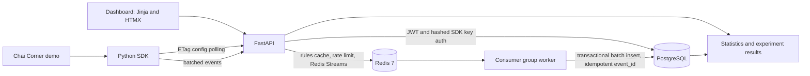

# Parakh

**Ship features safely, decide with data.**

Parakh is a portfolio feature-flag and A/B testing platform. A project defines
flags once, while each environment controls its own rollout and targeting
rules. The Python SDK downloads a versioned ruleset and evaluates locally, so a
normal flag check makes no network request. Exposure and conversion events
flow through Redis Streams to PostgreSQL for experiment analysis.

## Run locally in three steps

1. Copy `.env.example` to `.env`. Set a URL-safe random password and secret:

   ```powershell
   python -c "import secrets; print(secrets.token_hex(32))"
   ```

   Use one generated value for `POSTGRES_PASSWORD`, update `DATABASE_URL` to
   match, and generate a separate `JWT_SECRET`.
2. Start the services:

   ```powershell
   docker compose up --build
   ```
3. Open <http://localhost:8000>, register, create a project, add a flag, and
   enable it in Development. Create an SDK key from that environment's key
   page, set `PARAKH_SDK_KEY` in `.env`, then restart the demo service and open
   <http://localhost:8001>.

The API schema is at <http://localhost:8000/docs>. Docker Desktop (or Docker
Engine and Compose) is required for the full local stack. `GET /health` checks
process health; `GET /ready` checks PostgreSQL and Redis availability.

## Test and quality checks

```powershell
python -m pip install -r requirements-dev.txt
python -m pip install -e .\sdk
python -m pytest
python -m ruff check .
python -m ruff format --check .
python -m mypy backend/app/services/evaluation.py backend/app/services/statistics.py sdk/src/parakh_sdk --ignore-missing-imports
```

The backend tests use isolated SQLite and fakeredis; they do not require
PostgreSQL, Redis, or Docker. The SDK is installable from `sdk/`.

## API overview

| Area | Routes |
|---|---|
| Auth | `POST /api/v1/auth/register`, `/login`, `/logout`; `GET /api/v1/auth/me` |
| Projects | `/api/v1/projects` and `/api/v1/projects/{id}` |
| Environments | `/api/v1/projects/{id}/environments`, `/api/v1/environments/{id}` |
| Flags | `/api/v1/projects/{id}/flags`, `/api/v1/flags/{id}`, `/api/v1/environments/{id}/flags/{flag_id}` |
| SDK keys | `/api/v1/environments/{id}/sdk-keys`, `/api/v1/sdk-keys/{id}` |
| Evaluation | `POST /v1/evaluate`, `POST /v1/evaluate/all`, `GET /v1/config` |
| Events | `POST /v1/events` |
| Experiments | `/api/v1/projects/{id}/experiments`, `/api/v1/experiments/{id}/results`, `/api/v1/experiments/sample-size` |
| Monitoring | `GET /health`, `GET /ready` |

Dashboard pages provide project/flag management, per-environment rules and
rollouts, SDK key lifecycle, audit history, and experiment results. REST
management routes use bearer JWTs; SDK routes use environment-scoped SDK
keys. SDK key secrets are hashed in storage and returned only at creation.

## Architecture



## Load and performance

Use the Locust scenario in [loadtests/](./loadtests/). The target is p95 below
50 ms for config/evaluate requests after tuning, but this repository does not
claim a measured result: record the Locust environment and before/after
measurements in `loadtests/README.md` when running against a real deployment.

## Deployment

`render.yaml` provides a Render Blueprint for the API, worker, Postgres, and
Redis. Set `CORS_ORIGINS` to a JSON array of HTTPS dashboard origins. Review
plan availability and costs in the provider before deploying; the free-tier
availability of managed databases and Redis changes over time.

For Railway, deploy the API and worker from the same Docker context with
separate start commands, then attach managed PostgreSQL and Redis and set
`DATABASE_URL`, `REDIS_URL`, `JWT_SECRET`, `COOKIE_SECURE=true`, and
`CORS_ORIGINS`. For Fly.io, create an app and private Postgres/Redis services,
deploy the API and worker as separate process groups, and provide the same
secrets/configuration through `fly secrets`. Keep Redis private to the app
network; SDK keys are environment-specific credentials and should never be
committed.

## Screenshots

Add dashboard and experiment-results screenshots here after running the stack.

## Project learning materials

- [Architecture and data flow](./docs/architecture.md)
- [Phase-by-phase learning log and interview practice](./docs/LEARNING.md)
- [Design decisions and tradeoffs](./docs/design-decisions.md)
- [Five-minute demo script](./docs/demo-script.md)
- [What went wrong and what I learned](./docs/what-i-learned-template.md)

Live demo: _deployment link to be added_

