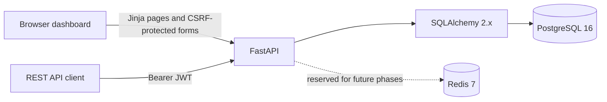

# Architecture

## Phase 1 request flow

The server-rendered dashboard and REST API share database models and ownership
checks. Dashboard forms authenticate with an HttpOnly cookie and signed
double-submit CSRF token; REST management uses bearer JWTs. Environment-scoped
SDK keys are stored as SHA-256 digests. SDK checks evaluate locally from a
polled ETag ruleset. Public API evaluation/config routes use Redis as a
ruleset cache and rate limiter. Event ingestion appends batches to Redis
Streams; a consumer-group worker batch-inserts events into PostgreSQL and
acknowledges them only after the transaction commits.
